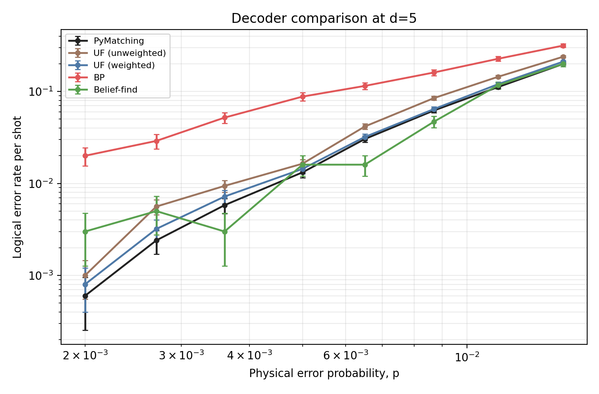
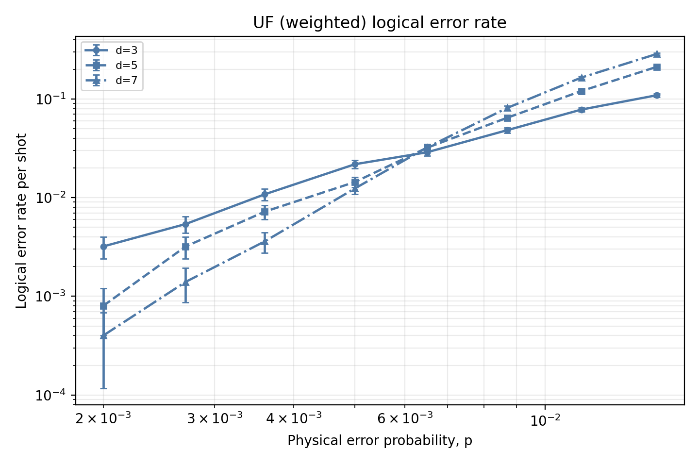
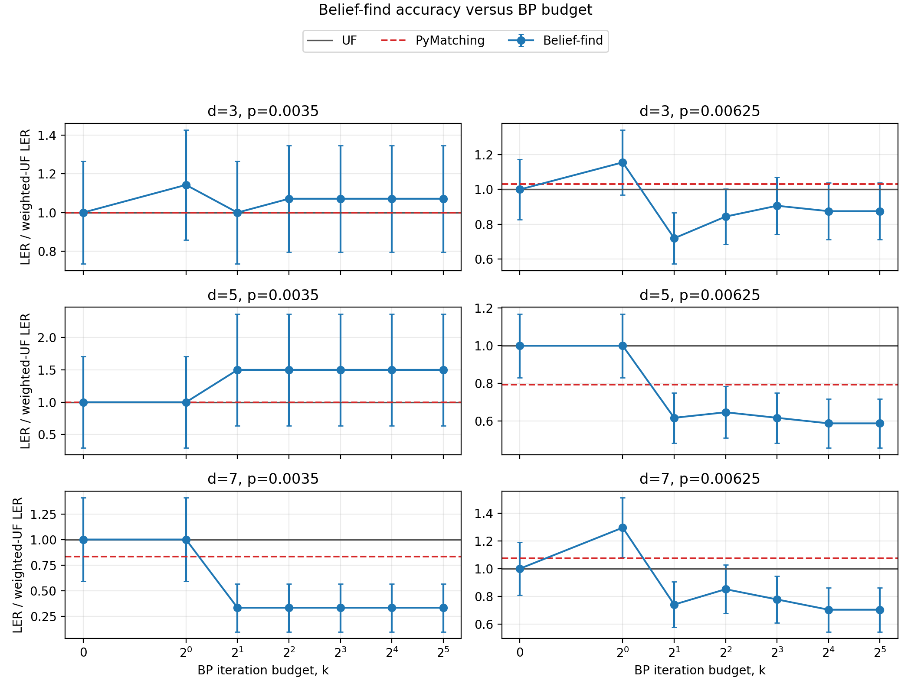
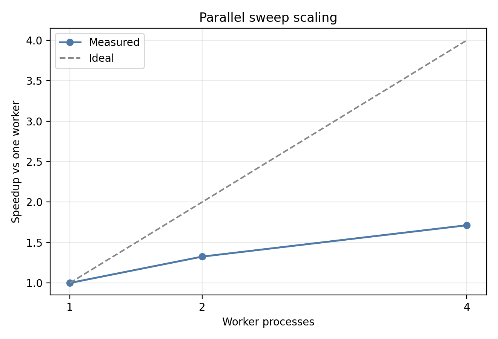

# Surface-code decoders: accuracy, latency, and parallelism

We built Union-Find, belief propagation (BP), and BP-guided Union-Find
(belief-find) surface-code decoders from scratch, then benchmarked them against
the optimized PyMatching minimum-weight perfect matching reference. The project
turns noisy rotated-surface-code circuits into detector syndromes, asks every
decoder to predict the logical observable flip through one common interface,
and measures the resulting accuracy–latency–parallelism tradeoff reproducibly.



## Quick start

Python 3.9 or newer is supported.

```bash
git clone https://github.com/ajayd241/quantum-error-correction-NG.git
cd quantum-error-correction-NG
python3 -m venv .venv
source .venv/bin/activate
python -m pip install --upgrade pip
python -m pip install -e ".[dev]"
pytest -q
```

## Run the decoders

The files in `src/qecdec/decoders/` are library modules; they are not intended
to be executed directly. Run them through `scripts/run_sweep.py`, which gives
every decoder the same seeded noise samples and writes comparable metrics.

Try all five implemented decoders at one small operating point:

```bash
python scripts/run_sweep.py \
  --decoders pymatching,uf_unweighted,uf,bp,belief_find \
  --distances 3 \
  --ps 0.005 \
  --shots 100 \
  --seed 1 \
  --workers 1 \
  --out results/quick_demo.csv
```

Run one decoder at a time:

```bash
# Optimized PyMatching reference
python scripts/run_sweep.py --decoders pymatching --distances 5 \
  --ps 0.005 --shots 1000 --out results/pymatching_demo.csv

# Unweighted Union-Find
python scripts/run_sweep.py --decoders uf_unweighted --distances 5 \
  --ps 0.005 --shots 1000 --out results/uf_unweighted_demo.csv

# Probability-weighted Union-Find
python scripts/run_sweep.py --decoders uf --distances 5 \
  --ps 0.005 --shots 1000 --out results/uf_demo.csv

# Min-sum belief propagation; alpha is the message-normalization factor
python scripts/run_sweep.py --decoders bp --distances 5 \
  --ps 0.005 --shots 250 --alpha 1.0 --out results/bp_demo.csv

# Belief-find with the final study's alpha=0.625 and two BP iterations
python scripts/run_sweep.py --config configs/final.yaml \
  --decoders belief_find --distances 5 --ps 0.005 --shots 250 \
  --workers 1 --skip-benchmark --out results/belief_find_demo.csv
```

Change `--distances 5` to a comma-separated grid such as `--distances 3,5,7`.
Likewise, `--ps 0.005` can become `--ps 0.002,0.005,0.01`; `p=0.005`
means a 0.5% physical error probability. Increase `--shots` for tighter error
bars, keep `--seed` fixed for reproducibility, and use `--workers N` to run
independent `(decoder, d, p)` points in parallel.

See **[docs/USAGE.md](docs/USAGE.md)** for every parameter, custom configs,
plotting, CSV columns, and examples of calling a decoder from Python.

Run the seeded final benchmark and regenerate every final figure:

```bash
python scripts/run_sweep.py --config configs/final.yaml
python scripts/plot_results.py results/final.csv \
  --parallel-csv results/parallel_speedup.csv \
  --budget-csv results/budget.csv \
  --out results/figs
```

The final config uses 5,000 shots per PyMatching/UF point and 1,000 per BP-family
point to keep the pure-Python sweep practical. Every CSV row records its shot
count and seed; low-noise points with fewer than 100 failures should be read as
noisy estimates, not precise rankings.

## Decoder lineup

Here, a *syndrome* is the pattern of detector events at the ends of possible
error chains. A decoder maps that pattern to a predicted logical flip.

| Decoder | Idea | Work per decode | Parallelism | Implementation |
|---|---|---:|---|---|
| PyMatching | Optimized sparse-blossom MWPM reference | Matching-dependent | Irregular/global | [`pymatching_ref.py`](src/qecdec/decoders/pymatching_ref.py) |
| UF (unweighted) | Grow odd clusters uniformly, merge, then peel a correction forest | Near-linear graph work | Local cluster growth | [`union_find.py`](src/qecdec/decoders/union_find.py) |
| UF (weighted) | Grow clusters by log-likelihood edge length | Near-linear graph work | Local cluster growth | [`union_find.py`](src/qecdec/decoders/union_find.py) |
| BP | Pass soft likelihood messages on the detector–fault graph | `O(kE)` for `k` iterations | Checks, variables, and shots | [`bp.py`](src/qecdec/decoders/bp.py) |
| Belief-find | Use BP posteriors to reweight the graph, then finish with UF | BP + weighted UF | BP plus local UF | [`belief_find.py`](src/qecdec/decoders/belief_find.py) |

The stretch NetworkX MWPM decoder was cut to protect time for testing and the
main comparison. P4 remains documented as optional work rather than being
presented as a completed decoder.

## Results

These measurements come from the seeded final sweep. Latencies are single-shot
Python timings on the development machine, so they compare implementations but
are not claims of hardware real-time speed.

| Decoder | Threshold estimate | LER/shot at `d=5, p=0.005` | p50 / p99 latency (µs) |
|---|---:|---:|---:|
| PyMatching | 0.719% | 0.0132 (66/5,000) | 5.33 / 15.25 |
| UF (unweighted) | 0.465% | 0.0164 (82/5,000) | 477.23 / 968.90 |
| UF (weighted) | 0.643% | 0.0144 (72/5,000) | 645.29 / 1516.87 |
| BP (min-sum) | No crossing in grid | 0.0880 (88/1,000) | 2610.92 / 15943.40 |
| Belief-find (`k=2`) | 0.774%† | 0.0160 (16/1,000) | 2051.35 / 3760.32 |

The threshold is the physical error probability where increasing code distance
stops reducing the logical error rate. The plotted d=5/d=7 values are estimated
by linear interpolation in log-log space; missing crossings are reported, not
extrapolated. †Belief-find's crossing uses only 1,000 shots per point, including
low-noise points with 0–5 failures, and is therefore substantially noisier than
the 5,000-shot matching/UF estimates.





The main finding from the paired budget study is that two BP iterations matched
32 iterations within sampling noise (83 versus 87 aggregate failures) while
using 50% of the mean p99 latency. More loopy-BP iterations were not
monotonically better. In the separate final sweep, however, `k=2` belief-find
measured 1.60% at `d=5, p=0.005` versus weighted UF's 1.44%; those unequal-size
samples are not a paired significance test, but they show that the cheaper
setting does not guarantee a win at every point. The BP-converged fast path
helped average work most at small distance, while p99 remained controlled by
hard shots that reached UF.



The 16-job scaling study took 3.21 s with one worker, 2.42 s with two, and
1.87 s with four: speedups of 1.33× and 1.71× rather than the ideal 2× and 4×.
Independent shots and operating points are parallelizable, but process startup,
decoder construction, and unequal job durations still limit end-to-end scaling.

## What is novel—and what is not

Belief-find is **not our invention**. BP-reweighted matching and Union-Find were
introduced by Higgott et al. Our contribution is an independent implementation
under the same interface as the other decoders, plus a reproducible study of
the BP iteration budget and an optional BP-converged fast path. The latter is
closely related to BP partial decoding studied by Caune et al.; both are
credited here and in the code.

The benchmark also makes negative results visible: standalone min-sum BP is
highly parallel, but short loops and surface-code degeneracy—many physically
equivalent error explanations—hurt its hard decisions as distance grows.

## Reproducibility and repository map

- [`configs/final.yaml`](configs/final.yaml) fixes decoders, distances,
  probabilities, shot budgets, algorithm options, seed, and worker counts.
- [`src/qecdec/harness.py`](src/qecdec/harness.py) is the single sampling,
  scoring, latency, and multiprocessing path.
- [`results/final.csv`](results/final.csv) contains the final sweep; all final
  plots are generated by [`scripts/plot_results.py`](scripts/plot_results.py).
- [`results/budget.csv`](results/budget.csv) and
  [`scripts/run_budget_study.py`](scripts/run_budget_study.py) reproduce the P3
  iteration-budget study.
- [`tests/`](tests/) includes graph invariants, single-fault checks,
  fixed-seed reproducibility, decoder equivalences, and statistical tests.

## Limitations and future work

- The noise model is Stim's uniform circuit-level depolarizing model on rotated
  Z-memory experiments with rounds equal to distance; results do not transfer
  unchanged to biased noise or other circuit schedules.
- The implementations prioritize clarity and correctness over optimized native
  performance. Python latency is not an FPGA or real-time estimate.
- Low-error points have fewer than 100 observed failures under the time-boxed
  shot budgets and therefore wider sampling uncertainty.
- The current decoder is batch/offline, not a sliding-window streaming system.
- Future work includes the optional NetworkX MWPM implementation, biased-noise
  studies, streaming decoding, and hardware-oriented parallel prototypes.

## References

1. deMarti iOlius et al., “Decoding algorithms for surface codes,”
   [arXiv:2307.14989](https://arxiv.org/abs/2307.14989), 2024.
2. Delfosse and Nickerson, “Almost-linear time decoding algorithm for
   topological codes,” *Quantum* 5, 595 (2021).
3. Higgott et al., “Improved decoding of circuit noise and fragile boundaries
   of tailored surface codes,” *PRX* 13, 031007 (2023),
   [arXiv:2203.04948](https://arxiv.org/abs/2203.04948).
4. Caune et al., “Belief propagation as a partial decoder,”
   [arXiv:2306.17142](https://arxiv.org/abs/2306.17142), 2023.
5. Higgott and Gidney, “Sparse Blossom,”
   [arXiv:2303.15933](https://arxiv.org/abs/2303.15933), 2023.
6. Gidney, “Stim: a fast stabilizer circuit simulator,” *Quantum* 5, 497
   (2021).

This project is available under the [MIT License](LICENSE).
