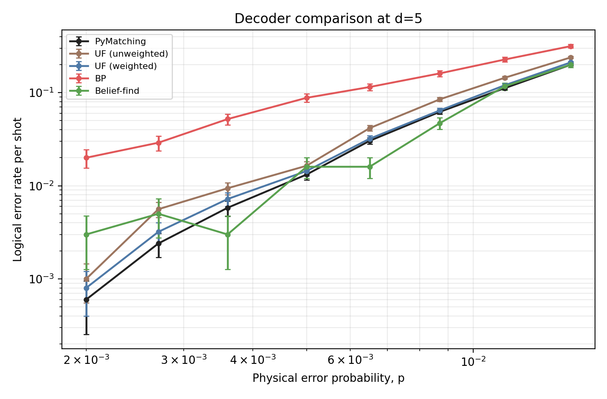
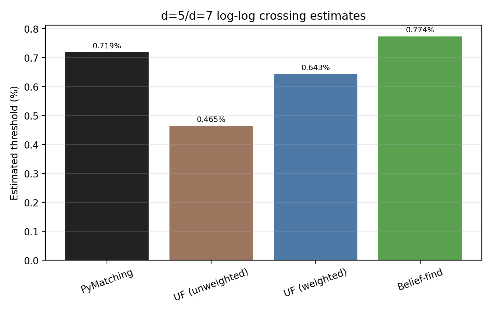
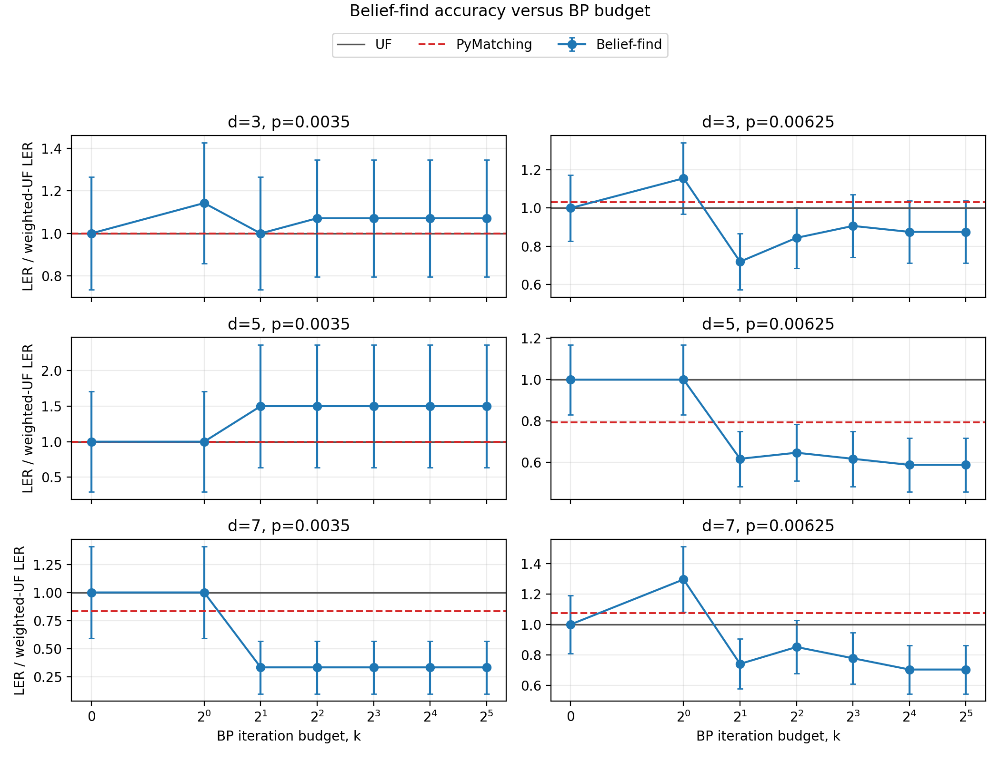
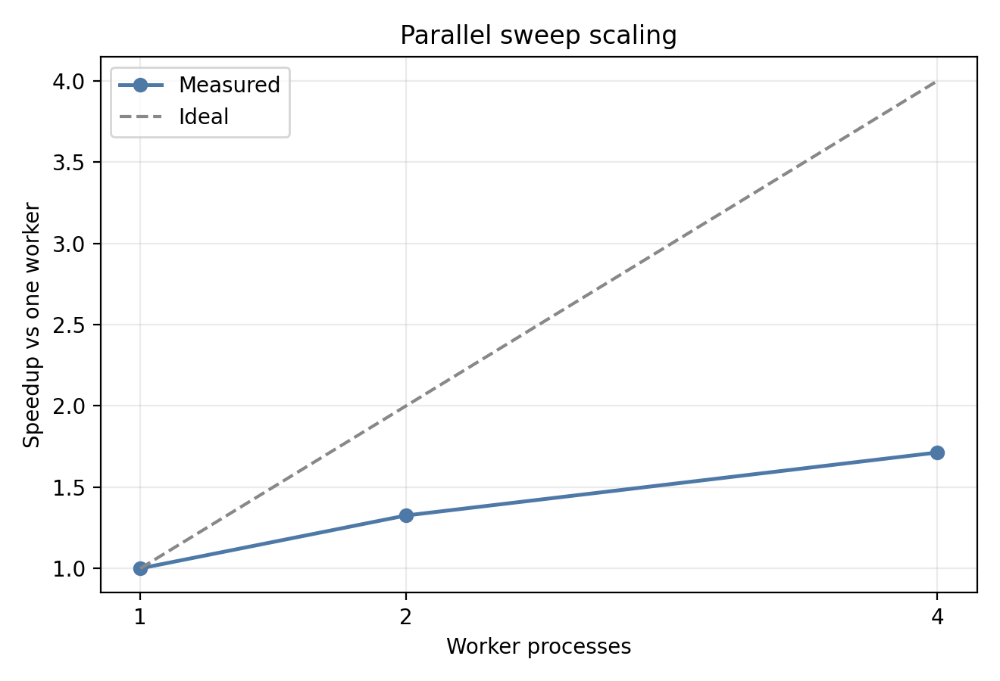

# Results interpretation: soft information needs a robust finisher

## The headline

> **Probability-aware local decoding recovers most of matching's accuracy. BP
> alone struggles on the loopy, degenerate surface-code graph, but its soft
> information becomes useful when Union-Find finishes the correction—and two
> BP iterations capture most of that benefit.**

That is the single narrative connecting the project. We did not build several
unrelated decoders merely to count them. Each decoder answers one question:

1. **PyMatching:** What does a strong accuracy reference look like?
2. **Unweighted UF:** How much accuracy do we lose for local, simple growth?
3. **Weighted UF:** How much of that loss comes from ignoring probabilities?
4. **BP:** Can highly parallel local messages decode the code by themselves?
5. **Belief-find:** Can BP supply soft information while UF supplies a robust
   final correction?

The resulting story is an accuracy–latency–parallelism tradeoff, not a claim
that one decoder wins every metric.

## How to read the experiment

The benchmark uses noisy rotated surface-code Z-memory circuits with code
distances `d = 3, 5, 7` and `rounds = d`. The physical error probability `p` is
applied to all four Stim circuit-noise processes. A decoder receives only the
detector syndrome and predicts whether the logical observable flipped.

The main accuracy metric is **logical error rate per shot (LER)**: the fraction
of complete experiments whose predicted logical value is wrong. Lower is
better.

The **threshold** is the approximate physical error probability where larger
codes stop helping. Below threshold, increasing `d` suppresses logical errors;
above threshold, the extra noisy operations outweigh the protection. The final
threshold figure estimates the crossing of the `d=5` and `d=7` curves by
interpolation in log-log space.

Latency is reported as median (**p50**) and tail (**p99**) single-shot decode
time. These are measurements of clear Python implementations, not hardware or
real-time performance claims.

## Act I: establish an honest ruler

PyMatching is the reference, not one of our decoders. Its optimized sparse
matching implementation sets the accuracy target and prevents us from grading
our own work against a weak baseline.

In the larger 20,000-shot baseline sweep, PyMatching's pairwise crossings were
0.699%, 0.695%, and 0.688%, giving a median threshold of approximately 0.695%.
The smaller final sweep estimated the `d=5`/`d=7` crossing at 0.719%. Those
values are consistent at the precision expected from different shot budgets
and crossing definitions.

At `d=5, p=0.005`, the final sweep measured 66 failures in 5,000 shots:

| Decoder | Failures / shots | LER | LER relative to PyMatching |
|---|---:|---:|---:|
| PyMatching | 66 / 5,000 | 1.32% | 1.00× |
| UF (unweighted) | 82 / 5,000 | 1.64% | 1.24× |
| UF (weighted) | 72 / 5,000 | 1.44% | 1.09× |
| BP | 88 / 1,000 | 8.80% | 6.67× |
| Belief-find, `k=2` | 16 / 1,000 | 1.60% | 1.21× |

The unequal 5,000- and 1,000-shot rows should not be read as a paired
significance test. Their purpose here is orientation; the stronger paired
belief-find evidence appears below.

## Act II: probability information is the largest simple win

Unweighted UF treats graph edges as equally plausible. Weighted UF gives each
edge a length derived from its log likelihood, so clusters preferentially grow
through more probable error mechanisms.

That one change recovered most of the gap to the matching reference:

- In the final sweep, weighted UF's LER was only 9% above PyMatching at
  `d=5, p=0.005`, compared with 24% for unweighted UF.
- Its final threshold estimate was 0.643%, or 89% of PyMatching's 0.719%; the
  unweighted estimate was 0.465%, or 65% of the reference.
- In the larger P1 sweep, weighted UF beat unweighted UF at all 24 matched
  `(d,p)` points, and its worst failure-count ratio to PyMatching was 1.22×.
- Both UF variants still corrected every tested single fault at `d=3` and
  `d=5`, so the performance gap is not a basic correctness failure. It appears
  when many competing multi-fault explanations become possible.

This is the cleanest engineering result in the project: **using probability
information mattered more than adding algorithmic complexity for its own
sake.** A local cluster decoder can approach the global matching reference if
its growth respects the physical noise model.

## Act III: BP is parallel, informative, and insufficient alone

Belief propagation passes likelihood messages between detector constraints and
possible error mechanisms. Its updates are local and can be performed in
parallel across graph edges and shots—an attractive structure for hardware.

But the surface-code factor graph contains many short loops, and the code is
**degenerate**: many physical error chains have the same syndrome and logical
effect. Ordinary BP behaves as though incoming messages were more independent
than they really are. It can become overconfident in a locally consistent
explanation that is not the best global correction.

The data show this failure mode rather than hiding it:

- BP had no `d=5`/`d=7` threshold crossing in the tested range.
- At `d=5, p=0.005`, the 20,000-shot BP study measured 7.165% LER, far above
  the matching and UF results. The smaller final sweep measured 8.80%.
- Near `p=0.00474`, BP convergence fell from 92.7% at `d=3` to 66.3% at `d=5`
  and 23.0% at `d=7`. Larger loopy graphs are precisely where standalone BP
  becomes less reliable.

This negative result is useful. BP's hard decision is not the product we need,
but its posterior beliefs still contain information about which faults and
edges are more plausible. That observation motivates the hybrid.

## Act IV: belief-find gives BP a robust finisher

Belief-find, introduced by Higgott et al., runs BP first, maps its posterior
fault probabilities back onto graph-edge weights, and then lets weighted UF
produce the final correction. BP ranks possibilities; UF enforces a complete
graph correction.

The strongest direct comparison used 5,000 paired shots at
`d=5, p=0.005`:

| Decoder | Failures | LER | One-sigma error |
|---|---:|---:|---:|
| Weighted UF | 71 / 5,000 | 1.42% | ±0.17 percentage points |
| Belief-find | 52 / 5,000 | 1.04% | ±0.14 percentage points |

Belief-find produced 27% fewer failures, and the one-sigma intervals did not
overlap. This supports a focused claim: **on this paired near-threshold
operating point, BP's soft information improved the UF correction.** It does
not prove that the hybrid dominates at every distance, noise level, or BP
budget.

The final `k=2` sweep illustrates that limitation. At `d=5, p=0.005`, it
measured 1.60% on 1,000 shots versus weighted UF's 1.44% on 5,000 shots. Those
unequal samples are not a significance test, but they are a useful warning:
the cheap hybrid setting does not guarantee a win at every finite sample.

## Act V: the useful BP budget is surprisingly small

Our main study is not the invention of belief-find; it is the question of how
much BP work is actually worth paying for.

Across six `(d,p)` panels with the fast path enabled:

| BP iterations `k` | Aggregate failures / shots | Aggregate LER | Mean p99 latency |
|---:|---:|---:|---:|
| 0 | 115 / 6,000 | 1.92% | 1,857 µs |
| 2 | 83 / 6,000 | 1.38% | 6,615 µs |
| 16 | 87 / 6,000 | 1.45% | 15,595 µs |
| 32 | 87 / 6,000 | 1.45% | 13,132 µs |

Two iterations matched the 32-iteration accuracy within sampling noise (83
versus 87 failures) at roughly half of the mean p99 latency. More iterations
were not monotonically better: `k=4`, `k=8`, `k=16`, and `k=32` all moved
slightly around the same noisy plateau.

That is the project's most interesting systems insight: **the valuable part of
BP arrives early.** Once short-range syndrome information has reshaped the
edge weights, extra loopy message passing can add cost without reliably adding
accuracy.

The BP-converged fast path skipped UF for some shots, but its usefulness
depended strongly on distance. At the largest BP budget it handled roughly
72.5–84.8% of `d=3` shots but only 1.0–5.3% at `d=7`. It therefore reduces
average work most on easy shots; p99 remains governed by the difficult shots
that do not converge and still require UF.

## Act VI: parallelizable does not mean instant

The latency table is intentionally humbling:

| Decoder | p50 at `d=5, p=0.005` | p99 | p50 relative to PyMatching |
|---|---:|---:|---:|
| PyMatching | 5.33 µs | 15.25 µs | 1× |
| UF (unweighted) | 477 µs | 969 µs | 89× |
| UF (weighted) | 645 µs | 1,517 µs | 121× |
| BP | 2,611 µs | 15,943 µs | 489× |
| Belief-find, `k=2` | 2,051 µs | 3,760 µs | 385× |

These numbers mostly compare software maturity: PyMatching is an optimized
native library, while our decoders are clarity-first Python references. They
do **not** establish that the UF or BP algorithms are intrinsically hundreds of
times slower in hardware. Their value is in showing the relative cost within
this implementation and the importance of the latency tail.

The process-level scaling study also showed diminishing returns:

| Workers | Wall time | Speedup | Parallel efficiency |
|---:|---:|---:|---:|
| 1 | 3.21 s | 1.00× | 100% |
| 2 | 2.42 s | 1.33× | 66% |
| 4 | 1.87 s | 1.71× | 43% |

Independent operating points are embarrassingly parallel, but process startup,
decoder construction, and unequal job durations limit end-to-end speedup on a
small workload. This is different from **algorithm-level parallelism**: BP's
message updates and UF's local cluster operations may still map well to custom
parallel hardware even when Python multiprocessing scales poorly.

## What we can claim confidently

| Claim | Evidence strength | Why |
|---|---|---|
| Weighted UF beats unweighted UF | **Strong** | It won all 24 matched points in the 20,000-shot P1 sweep and passes all single-fault checks. |
| Weighted UF approaches PyMatching accuracy | **Strong** | It stayed within 1.22× of PyMatching's failure count across P1 and reached 89% of the final threshold estimate. |
| Standalone BP is weak on this surface-code graph | **Strong** | A 20,000-shot exact point, the full grid, worsening convergence with distance, and no final crossing agree. |
| BP beliefs can improve UF | **Strong but local** | The paired 5,000-shot point showed 52 versus 71 failures with non-overlapping one-sigma intervals. |
| `k=2` captures most of the hybrid benefit | **Moderate** | It matched `k=32` on 6,000 aggregate shots while halving mean p99, but individual points remain noisy. |
| Belief-find has a higher threshold than PyMatching | **Suggestive only** | The 0.774% estimate used 1,000 shots per point and includes low-noise points with 0–5 failures. More shots are required. |
| Our Python latency predicts hardware latency | **Not supported** | It compares a native optimized reference with pedagogical Python implementations. |

This table is the boundary between interpretation and overclaiming. The
belief-find threshold bar is a reason to run a larger experiment, not a reason
to declare a new state of the art.

## The 90-second narrative

> We started with PyMatching as an honest gold-standard ruler. Plain
> Union-Find gave us a local, hardware-friendly decoder, but it threw away the
> fact that some faults are more likely than others. Adding likelihood weights
> recovered most of the accuracy gap: weighted UF was only 9% above
> PyMatching's logical error rate at our central operating point and beat
> unweighted UF everywhere in the larger sweep.
>
> We then tried belief propagation because its local message updates are highly
> parallel. Standalone BP was our negative result: loops and degeneracy made it
> much less accurate, especially as distance grew. But its soft beliefs were
> still useful. Belief-find uses those beliefs to reweight the graph and lets UF
> finish the correction. On a paired 5,000-shot test it reduced failures from
> 71 to 52.
>
> Our new question was how much BP is actually needed. Two iterations matched
> 32 iterations within sampling noise at about half the mean p99 latency. So the
> lesson is not “run more BP.” It is “extract a little local soft information,
> then hand the problem to a robust graph decoder.” Finally, our 4-worker sweep
> reached only 1.71× speedup, reminding us that parallel structure still needs
> careful systems engineering. The project therefore tells one honest story:
> probability information is valuable, hybrids can beat either component, and
> the best accuracy–latency point appears well before the largest iteration
> budget.

## The closing sentence

**The best decoder in this study is not a single algorithmic extreme; it is a
carefully budgeted handoff from parallel soft inference to robust local graph
correction.**

## Source data

- Final sweep: [`results/final.csv`](../results/final.csv)
- Threshold estimates: [`results/threshold_estimates.csv`](../results/threshold_estimates.csv)
- Belief-find budget study: [`results/budget.csv`](../results/budget.csv)
- Parallel-scaling study: [`results/parallel_speedup.csv`](../results/parallel_speedup.csv)
- Full experiment log: [`docs/PROGRESS.md`](PROGRESS.md)

Belief-find is credited to Higgott et al.; BP partial decoding is related to
Caune et al. The complete references and scope limitations are in the
[README](../README.md#references).
